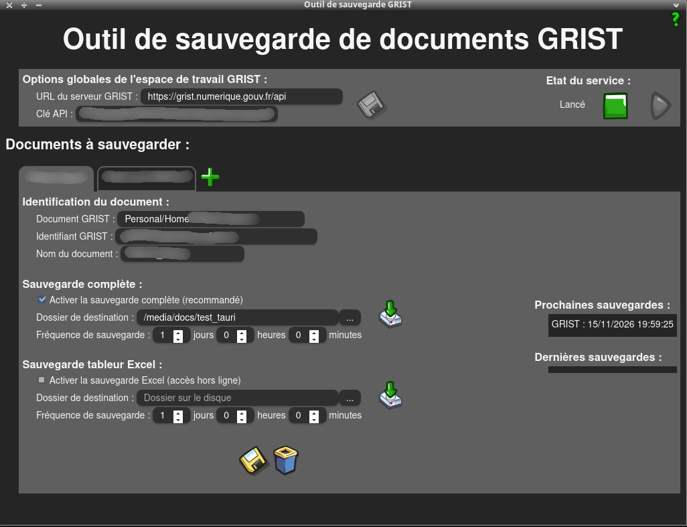

# GRIST backup

Tool to automate GRIST backups

## details

This app run in systray, with a UI to configure the backups.

- Connexion to GRIST API is done via the API key (nooauth supported at the moment)
- You can manage as many documents as you want
- You can backup document in GRIST version (full datas) or in xlsx format (mainly usefull to keep an offline version)
- For each backup, you can specify the frequence and the destination.

## License

This app is provided under `GPL-3.0-or-later`you can get it here : [www.gnu.org/licenses/gpl-3.0.en.html#license-text](https://www.gnu.org/licenses/gpl-3.0.en.html#license-text)

## Build

This app is written using the Tauri framework, with vanilla javascript/html/css as frontend.
Please see Tauri docs for instruction to compile the app : [v2.tauri.app](https://v2.tauri.app/)
