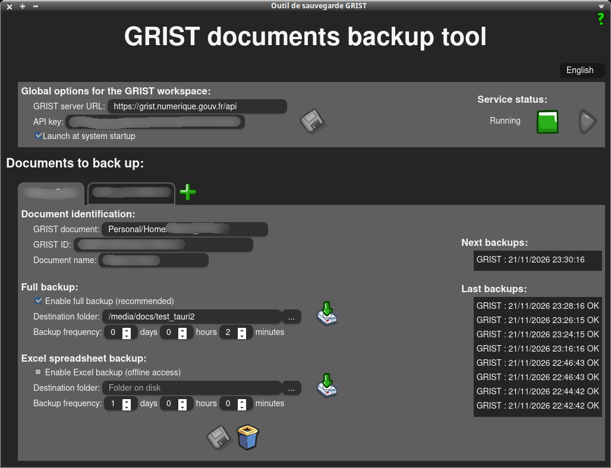

# GRIST backup

Tool to automate GRIST backups.

## Details

This app runs in the system tray, with a UI to configure the backups.

- Connection to the GRIST API is done via the API key (no OAuth support at the moment).
- You can manage as many documents as you want.
- You can back up a document either in GRIST format (full data) or in XLSX format (mainly useful to keep an offline copy).
- For each backup, you can specify the frequency and the destination.
- If you wish, you can configure the application to launch automatically when the operating system starts up.

GRISTbackup is available in English or French.

## License

This app is provided under `GPL-3.0-or-later`. You can get the license here: [www.gnu.org/licenses/gpl-3.0.en.html#license-text](https://www.gnu.org/licenses/gpl-3.0.en.html#license-text)

## State

This tool is currently in the alpha phase. Tests have been mainly done on Linux (and a little bit on Windows 10). MacOS has not been tested ("blind" builds)

## Build

Packages for main platforms are compiled regularly. You can find the latest versions here : [github.com/AlicVB/GRIST-backup/releases/latest](https://github.com/AlicVB/GRIST-backup/releases/latest)

If you want to build Grist-backup yourself, this app is written using the Tauri framework, with vanilla JavaScript/HTML/CSS for the frontend.
Please see the Tauri docs for instructions on how to compile and bundle the app : [v2.tauri.app](https://v2.tauri.app/)
